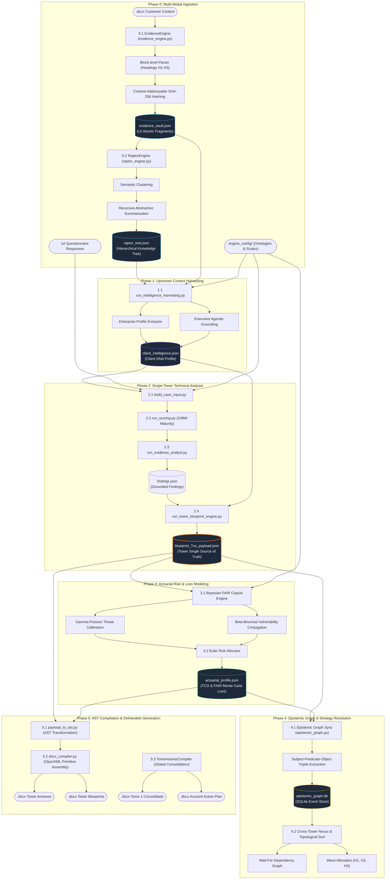

# Assessment Factory Flow Specification

Canonical execution specification defining the end-to-end data pipeline of the `assessment-engine` platform, from multi-modal customer evidence ingestion to compiled OpenXML `.docx` deliverables.

---

## 1. End-to-End Pipeline DAG

The following flowchart captures the six sequential execution phases across deterministic Python compute and bounded LLM synthesis:

---

## 2. Core Execution Mechanisms

### 2.1 Multi-Modal Ingestion (`EvidenceEngine` & `RaptorEngine`)
- **Deterministic Chunking (`EvidenceEngine`):** Decomposes raw `.docx` and `.txt` files into content-addressable `EvidenceFragment` records indexed by deterministic SHA-256 hashes. Headings ($H1$ to $H3$) are tracked across paragraphs to preserve semantic context.
- **Hierarchical Clustering (`RaptorEngine`):** Constructs a recursive tree (`raptor_tree.json`). Leaf fragments are grouped by semantic proximity and summarized via bounded LLM invocations across levels ($L_1, L_2$) with rate-limiting backoff.

### 2.2 Grounded Single-Tower Synthesis (`run_tower_blueprint_engine.py`)
- **Pillar-Aligned Evaluation:** Maps customer questionnaire scores and evidence fragments against tower-specific pillars.
- **Contract-First Synthesis:** Synthesizes `blueprint_<tower>_payload.json` validating strictly against `src/assessment_engine/domain/schemas/blueprint.py`.
- **Definition of Done (DoD):** Blueprints require quantitative maturity scores (1.0 to 5.0), explicit gap analyses, and sized remediation initiatives ($S, M, L, XL$).

### 2.3 Actuarial Risk Modeling (`bayesian_fair_copula_engine.py`)
- **Dual Engine:** Couples Total Cost of Ownership (TCO) with Factor Analysis of Information Risk (FAIR).
- **Bayesian Updating:** Evaluates Loss Event Frequency (LEF) and Vulnerability (VULN) using Gamma-Poisson and Beta-Binomial conjugate distributions conditioned on empirical evidence in `evidence_ledger.json`.
- **Euler Capital Allocation:** Allocates portfolio-level Value at Risk (VaR) across technology towers based on marginal risk contributions.

### 2.4 Epistemic Graph Sync (`epistemic_graph.py`)
- **Semantic Triplets:** Ingests findings and initiatives into an SQLite event-sourcing graph as formal relational assertions:
  $$\langle \text{Project ID} \rangle \xrightarrow{\text{REQUIRES}} \langle \text{Dependency ID} \rangle$$
  $$\langle \text{Risk ID} \rangle \xrightarrow{\text{IMPACTS}} \langle \text{Pillar ID} \rangle$$
- **Topological Sorting:** Resolves the dependency DAG to assign transformation initiatives into non-conflicting delivery waves ($H_1, H_2, H_3$).

### 2.5 AST Presentation Compilation (`docx_compiler.py`)
- **Exclusive DOCX Monism:** Compiles structured JSON payloads into Microsoft Word (`.docx`) through intermediate Abstract Syntax Trees (AST).
- **Separation of Concerns:** Compilers (`payload_to_ast.py`, `docx_compiler.py`, `tomo_asis_ast_compiler.py`) only format and layout pre-calculated metrics. Recalculation or mutation of domain data in presentation logic is prohibited.
