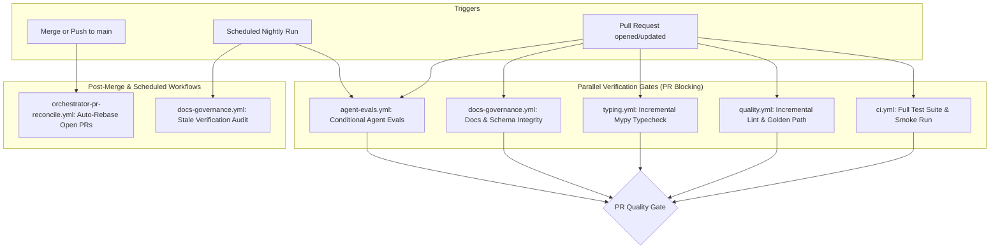

# CI/CD Workflows & Automated Quality Gates

Canonical operational specification detailing the continuous integration pipelines, scheduled regression gates, and automated pull request reconcilers implemented via GitHub Actions.

---

## 1. Automated Pipeline Execution Graph

Workflows trigger across pull requests, pushes to `main`, and scheduled cron timers:

---

## 2. Workflow Specifications & Operational Invariants

### 1. `ci.yml` (Core Integration Pipeline)
- **Triggers:** Pull requests and pushes targeting `main` or `develop`.
- **Execution Matrix:**
  - `pytest`: Executes unit, integration, and architecture test suites under Python 3.11.
  - Smoke Dry-Run: Validates physical pipeline artifact generation via `regenerate_smoke_artifacts.py --dry-run`.
- **Quality Gate:** All tests must exit with code `0`. Any regression or unhandled exception halts the PR.

### 2. `quality.yml` (Incremental Quality & Style Gate)
- **Triggers:** Pull requests and pushes modifying Python source code or configurations.
- **Execution Matrix:**
  - `run_incremental_quality_gate.py`: Analyzes files modified relative to `origin/main`.
  - `ruff check` & `ruff format --check`: Validates linting rules and code formatting.
  - `run_golden_path_check.py`: Asserts architectural fitness and adherence to `templates/golden_paths/`.
  - `import-linter`: Enforces strict layered architecture, blocking illegal dependencies (e.g., `domain \to infrastructure`).

### 3. `typing.yml` (Incremental Static Typing Gate)
- **Triggers:** Pull requests altering `.py` files.
- **Execution Matrix:**
  - `run_incremental_typecheck.py`: Invokes `mypy` strictly on changed modules and their direct dependents.
  - Invariant: Zero type errors allowed; implicit `Any` casts in core domain schemas trigger gate failure.

### 4. `docs-governance.yml` (Documentation & Contract Integrity Gate)
- **Triggers:** Pull requests, pushes to `main`, and daily schedule (`04:23 UTC`).
- **Execution Matrix:**
  - `validate_documentation_governance.py`: Validates front matter parity, broken Markdown links, freshness deadlines, and forbidden hype tokens.
  - `validate_contracts_schemas.py`: Asserts 100% type alignment between Markdown contract tables and Pydantic models.
  - `validate_documentation_snippets.py`: Verifies that CLI snippets and Python imports in documentation resolve to existing files.
  - `lint_documentation_style.py`: Asserts structural style rules and suppresses marketing buzzwords.
  - `build_docs_site.py`: Compiles and uploads preview artifacts for visual inspection.

### 5. `agent-evals.yml` (Autonomous Agent Evaluation Gate)
- **Triggers:** Modifying prompts in `engine_config/prompts/`, agent evaluators, or nightly cron.
- **Execution Matrix:**
  - Evaluates generative accuracy, adherence to constraints, and hallucination containment across multi-tower test scenarios.

### 6. `orchestrator-pr-reconcile.yml` (Post-Merge Auto-Reconciler)
- **Triggers:** Workflow completion upon push/merge to `main`.
- **Execution Matrix:**
  - Executes `scripts/reconcile_prs.sh` via GitHub CLI (`gh`).
  - Automatically fetches all open pull requests and merges `origin/main` into their feature branches to eliminate merge skew.

---

## 3. Operational Rules for AI Agents

1. **Gate Invariance:** Agents must NEVER edit workflow YAML files to disable or skip failing checks.
2. **Local Preflight:** Run local incremental scripts (`run_incremental_quality_gate.py`, `run_incremental_typecheck.py`) before opening PRs.
3. **No Force Flags:** Using `--force` or `--admin` on git and GitHub CLI operations is strictly banned by repository governance laws.
